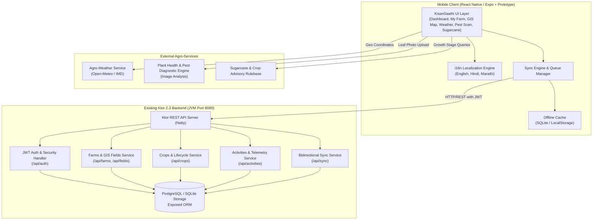
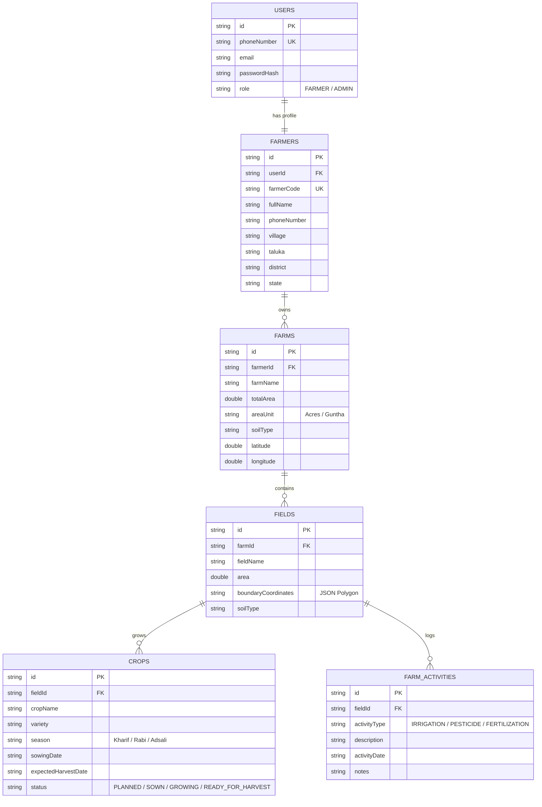
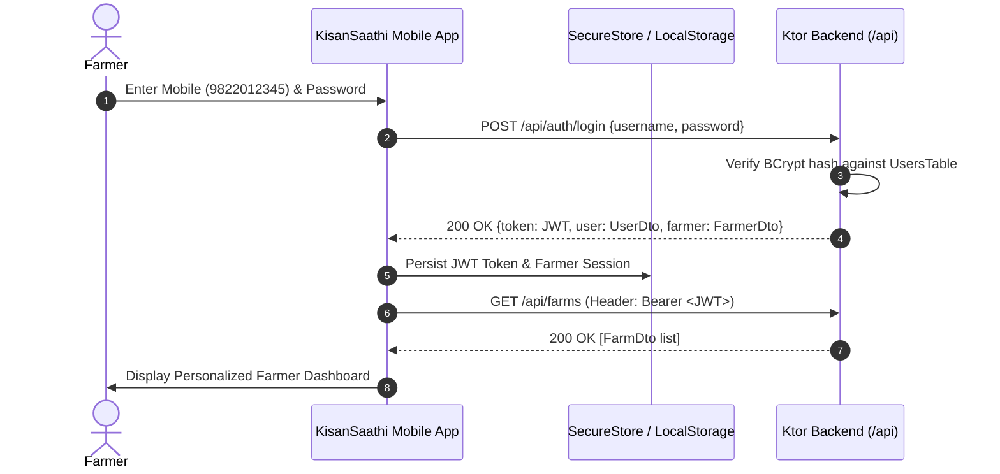

# KisanSaathi — Integration Architecture Specification

**Product:** KisanSaathi — Multilingual Farmer Mobile Application  
**Architect:** Senior Full-Stack & React Native Architect  
**Version:** 1.0 (Phase 1 Deliverable)  

---

## 1. Architectural Overview

The KisanSaathi architecture connects an accessible, responsive mobile frontend to existing domain services, backend REST APIs, and external agricultural intelligence engines. 

---

## 2. Existing Backend Inspection & Endpoint Inventory

The backend located in `C:\Sam's Work\Kotlin-Farmer App\backend` is an existing, operational Ktor service written in Kotlin with Exposed ORM.

### 2.1 Discovered REST API Endpoints

| Method | Endpoint | Description | Auth Required | Request Payload | Response Schema |
|---|---|---|---|---|---|
| `POST` | `/api/auth/login` | Authenticates farmer by phone/email and password | No | `LoginRequest(username, password)` | `ApiResponse<AuthResponse>` (JWT token, user & farmer profile) |
| `POST` | `/api/auth/register` | Registers new farmer profile | No | `RegisterRequest(fullName, phoneNumber, email, password, village, taluka, district, state)` | `ApiResponse<AuthResponse>` |
| `POST` | `/api/auth/logout` | Invalidates farmer session | Yes (JWT) | None | `ApiResponse<Unit>` |
| `GET` | `/api/farmers/me` | Fetches active farmer profile details | Yes (JWT) | None | `ApiResponse<FarmerDto>` |
| `GET` | `/api/farms` | Returns all farms owned by the farmer | Yes (JWT) | None | `ApiResponse<List<FarmDto>>` |
| `GET` | `/api/farms/{id}` | Returns single farm with soil and geo specs | Yes (JWT) | None | `ApiResponse<FarmDto>` |
| `GET` | `/api/fields` | Returns all field plots with GPS boundary polygons | Yes (JWT) | None | `ApiResponse<List<FieldDto>>` |
| `GET` | `/api/crops` | Returns active crop cycles and growth statuses | Yes (JWT) | None | `ApiResponse<List<CropDto>>` |
| `GET` | `/api/activities` | Returns logged agronomy tasks (irrigation, spray, etc.) | Yes (JWT) | None | `ApiResponse<List<ActivityDto>>` |
| `GET` | `/api/sync/status` | Heartbeat & backend sync readiness probe | No | None | `Map<String, String>` (`status: healthy`) |
| `POST` | `/api/sync` | Batch synchronization endpoint for offline edits | Yes (JWT) | `SyncBatchRequest(items: List<SyncItem>)` | `ApiResponse<SyncBatchResponse>` |

### 2.2 Domain Entities & Schema Definition

---

## 3. Integration Strategy for the 5 Modules

### Module 1: Weather & Weather-Based Advisory
- **Data Source**: Integrated with Open-Meteo Agro API (no private key needed) using the farmer's coordinates (default: Baramati/Pune `18.1523° N, 74.5768° E`).
- **Telemetry Calculated**:
  - Temperature (°C), Humidity (%), Wind Speed (km/h), Precipitation probability (%), Pressure (hPa).
  - Daily UV Index and Astronomical cycle (Sunrise & Sunset timestamps).
- **Rule-Based Agro Advisories**:
  - *Spray Window Advisory*: If wind speed < 15 km/h, humidity between 50-80%, and rain probability < 20% -> *"Optimal day for pesticide and foliar fertilizer application."*
  - *Irrigation Advisory*: If forecasted rainfall > 15mm in next 24h -> *"Hold scheduled irrigation to prevent waterlogging and nutrient leaching."*

### Module 2: Pest & Disease Detection & Prevention
- **User Flow**: Farmers select the crop (Tomato, Sugarcane, Wheat, Onion, Cotton), capture/upload a photo of the affected leaf/stem, and receive a diagnosis.
- **Diagnostic Output**:
  - Disease Name (in EN, HI, MR).
  - Confidence Score (e.g., 94%).
  - Severity Level (Low, Medium, Critical).
  - Primary Symptoms.
  - Organic Remedy (e.g., Neem oil extract 5ml/L, Trichoderma viride).
  - Chemical Remedy (e.g., Mancozeb 75% WP @ 2.5g/L, Chlorpyrifos).
  - Prevention Checklist.
- **Disclaimer**: Clear note displayed that diagnostic results in the prototype are simulated for advisory purposes.

### Module 3: Sugarcane Cultivation & Guidance
- **Variety Target**: **Co-86032 (Nira)** and **Co-0238**, the dominant commercial cultivars in Maharashtra, Karnataka, and Uttar Pradesh.
- **Lifecycle Stages**:
  1. *Germination Phase (Days 1–35)*: Soil moisture maintenance, sett treatment with carbendazim.
  2. *Tillering Phase (Days 36–100)*: Nitrogen top-dressing, earthing up, weed control.
  3. *Grand Growth Phase (Days 101–270)*: Heavy irrigation demand, potash application, stem borer monitoring.
  4. *Ripening & Maturity Phase (Days 271–360)*: Gradual irrigation withdrawal, Brix testing (>18% Brix), trash mulching.
- **Calculators Included**:
  - Sett rate calculator per Acre.
  - Fertilizer dose calculator (N:P:K 250:115:115 kg/ha).
  - Drip irrigation schedule based on soil type.

### Module 4: GIS Farm & Field Boundary Mapping
- **Integration**: Leverages the field polygons seeded in `FarmerDatabaseWrapper.kt`:
  - Field 1: North Canal Block (4.0 Acres)
  - Field 2: Well Plot (5.0 Acres)
  - Field 3: Roadside Plot (3.5 Acres)
- **Visual Presentation**:
  - Interactive canvas/SVG map rendering the farm layout.
  - Color-coded boundary outlines representing crop types and moisture status.
  - Plot inspection modal showing crop stage, soil type, and GPS vertex coordinates.

### Module 5: Agronomy Telemetry, Activities & Offline Sync
- **Integration**: Reuses the `/api/activities` and `/api/sync` endpoints of the Ktor server.
- **Offline Sync Queue**:
  - Client logs activities offline into local storage.
  - Sync status indicator: Green (`Synced`), Amber (`Pending - 3 changes`), Blue (`Syncing`).
  - Auto-synchronization on network reconnect with idempotency keys.

---

## 4. Network Topology & Emulator Architecture

Running mobile applications against local backends on Windows requires explicit IP configuration:

| Client Environment | Backend Address | Explanation |
|---|---|---|
| **Web Browser (HTML Prototype)** | `http://localhost:8080` | Direct same-machine loopback |
| **Android Emulator (AVD)** | `http://10.0.2.2:8080` | `10.0.2.2` is the special Android loopback alias routing to the Windows host's `localhost` |
| **Physical Phone (Expo Go / APK)** | `http://<WIFI_LAN_IP>:8080` | Requires both phone and PC to be on the same local Wi-Fi subnet; Windows Defender firewall port 8080 must be open |

---

## 5. Security & Authentication Flow

1. **Token Persistence**: JWT stored securely (Expo `SecureStore` in mobile, `localStorage` in prototype).
2. **Session Expiry**: Interceptor catches `401 Unauthorized` and cleanly navigates the farmer back to the login screen with a friendly message.
3. **Data Isolation**: All backend SQL queries enforce `where farmerId = :farmerId` extracted from the verified JWT claims.
