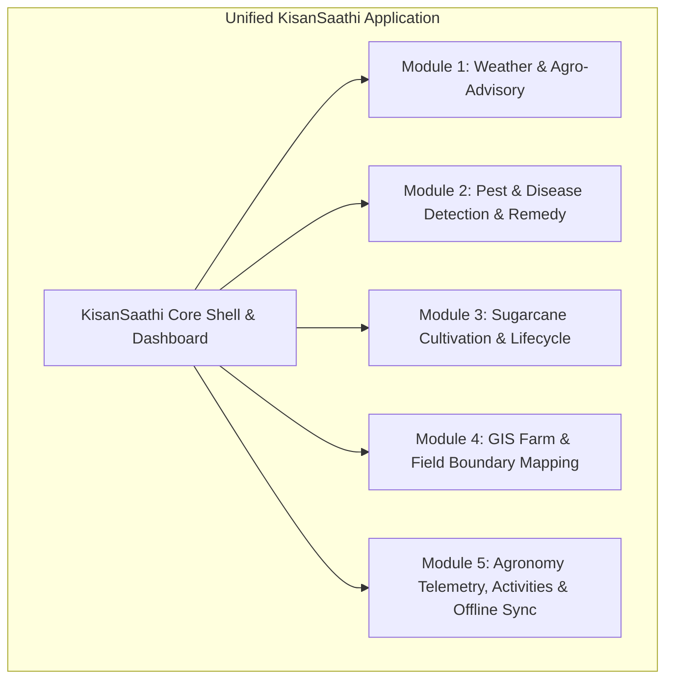
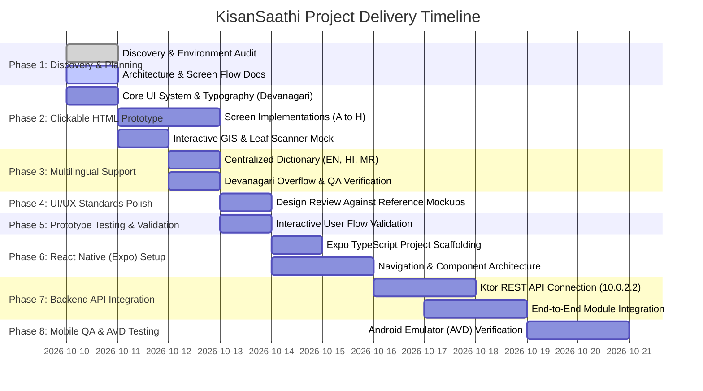

# KisanSaathi — Project Plan & Discovery Report

**Product Name:** KisanSaathi — Better Farming, Brighter Future  
**Role:** Senior Full-Stack Developer, React Native Architect, UI/UX Designer & QA Engineer  
**Date:** October 10, 2026  
**Status:** Phase 1 Complete — Awaiting Plan & Architecture Approval  

---

## 1. Executive Summary

**KisanSaathi** is a unified, multilingual mobile platform tailored specifically for Indian farmers. The platform consolidates five vital agricultural capabilities into an intuitive, high-utility, visually engaging mobile experience that bridges field operations, agronomic intelligence, and crop management.

Rather than developing redundant systems, the project reuses and integrates existing modules and assets discovered in the environment, specifically the production-grade **Kotlin Multiplatform (KMP) & Ktor REST backend** discovered in `C:\Sam's Work\Kotlin-Farmer App`.

---

## 2. Workspace & Environment Discovery

A comprehensive scan of `C:\Sam's Work` and the local developer environment was conducted to identify existing assets, libraries, backends, and databases.

### 2.1 Discovered Repositories & Modules

| Path | Category | Tech Stack | Status / Reusability |
|---|---|---|---|
| `C:\Sam's Work\Farmer-Mobile_App` | Root Workspace | Target directory for mobile application & prototype | Active development workspace |
| `C:\Sam's Work\Kotlin-Farmer App` | Existing Production System | Kotlin Multiplatform (KMP), Compose Multiplatform, Ktor 2.3.11, PostgreSQL 16, Exposed ORM, SQLDelight 2.0.2 | **High Reusability**: Complete backend REST API, database schemas, and domain data models |
| `C:\Users\Admin\.farmer_backend_data` | Backend Storage | H2 database (`farmer_db.mv.db`) | Active backend data store |
| `C:\Users\Admin\.farmer_platform` | Client Storage | SQLite database (`farmer_app.db`) | Seeded local database with realistic Indian farm records |

### 2.2 System & Tooling Inspection

- **Node.js**: `v24.19.0` (Installed and active)
- **npm**: `11.17.0` (Executable via `npm.cmd` due to Windows PowerShell execution policy)
- **Git**: `2.56.0.windows.1` (Available)
- **Java**: JDK 17 located at `C:\Users\Admin\.jdk17\jdk-17.0.20.1+1`
- **Python**: `3.11.9`
- **Android SDK / Emulator**: Not currently added to the system PATH. Will be configured with Android Studio in Phase 6.

---

## 3. Identification of the Five Functional Modules

Based on the project requirements and codebase analysis of `Kotlin-Farmer App`, the five core functional modules have been identified as follows:

### Module 1: Weather & Weather-Based Farming Advice
- **Scope**: Hyper-local current weather conditions, 7-day agricultural forecast, humidity, precipitation, wind speed, pressure, and sunrise/sunset astronomical cycle.
- **Agricultural Decision Engine**: Real-time actionable guidance based on weather (e.g., *"Cloudy conditions with 76% humidity — Safe for pesticide spray today; avoid spraying if rain probability exceeds 60%"*).
- **Integration Target**: Open-Meteo / IMD (India Meteorological Department) weather API combined with agronomic rules.

### Module 2: Pest & Disease Detection and Prevention
- **Scope**: Crop leaf symptom capture and image upload preview, visual AI scanning simulation, disease identification (e.g., Early Blight in Tomato, Red Rot in Sugarcane, Rust in Wheat), symptom breakdown, organic vs chemical treatment recommendations, and preventive steps.
- **Reference Match**: Matches the modern AI Plant Health scanner provided in the design reference with split-screen visual diagnostics and actionable recommendations.

### Module 3: Sugarcane Cultivation and Crop Guidance
- **Scope**: Deep-dive agronomic lifecycle guide for Sugarcane (*Saccharum officinarum*), specifically focusing on popular Indian varieties like **Co-86032 (Nira)** and **Co-0238**.
- **Key Features**: Stage-by-stage guidance (Germination, Tillering, Grand Growth, Maturity/Harvest), water & drip irrigation management, fertilizer top-dressing schedules, pest control (Borer & Pyrilla), and Brix-meter harvest readiness indicators.

### Module 4: Interactive GIS Farm & Field Boundary Mapping *(Identified from `Kotlin-Farmer App`)*
- **Discovered Source**: `com.farmer.app.presentation.map.FarmMapScreen` & `FieldsTable.boundaryCoordinates` in `Kotlin-Farmer App`.
- **Scope**: Visual farm overview with GPS polygon boundary coordinates (e.g., North Canal Block 4.0 Acres, Well Plot 5.0 Acres, Roadside Plot 3.5 Acres), area calculation in Acres/Guntha, soil type categorization (Deep Black Cotton Soil, Clay Loam), and satellite/hybrid map rendering.

### Module 5: Agronomy Telemetry, Field Activities & Offline Sync *(Identified from `Kotlin-Farmer App`)*
- **Discovered Source**: `com.farmer.backend.routes.syncRoutes`, `FarmActivitiesTable`, and `FarmReportsScreen` in `Kotlin-Farmer App`.
- **Scope**: Field operation logging (Irrigation, Fertilization, Pesticide Spray, Weeding, Harvesting, Soil Testing), plant telemetry metrics (Plant Health Index 95%, Soil Moisture 72%, Soil pH 6.8), 7-day spline growth charts, and offline-first queue synchronization.

---

## 4. UI/UX Design Direction (Aligned with Reference Screens)

The user experience follows the provided reference designs:
1. **Lush Agricultural Palette**: Deep forest green (`#14532D`, `#166534`), energetic sprout green (`#22C55E`, `#15803D`), clean porcelain backgrounds (`#F8FAF8`, `#F1F5F1`), and warm earth accents.
2. **Farmer-Centric Layout**:
   - Header with friendly greeting in Hindi/Marathi/English, location, profile avatar, and audio-assisted search.
   - Prominent weather card with temperature, rainfall forecast, and immediate spray advisory.
   - Visual My Farm card with aerial crop photography, field boundary badges, and crop health status.
   - Quick-access module grid for Weather, Pest Scan, Sugarcane, GIS Fields, and Agronomy Log.
3. **Multilingual First**: Every UI label, alert, guide, and navigation button is localized into English, Hindi (हिंदी), and Marathi (मराठी) with proper Devanagari Unicode typography.

---

## 5. Development Roadmap & Phased Execution

---

## 6. Assumptions & Missing Information

### Verified Assumptions:
1. The Ktor backend in `C:\Sam's Work\Kotlin-Farmer App\backend` serves as the primary authentication and farm-data authority (`/api/auth`, `/api/farms`, `/api/fields`, `/api/crops`, `/api/activities`, `/api/sync`).
2. The prototype phase will use local in-memory/simulated data so it can be previewed immediately in any browser without needing background servers running.
3. The real mobile implementation will run on React Native with Expo and TypeScript, communicating with the backend via IP `10.0.2.2` (standard Android emulator loopback).

### Missing Information & Clarifications for User:
1. **Module 4 & 5 Confirmation**: Please confirm that **Interactive GIS Farm & Field Mapping** and **Agronomy Telemetry & Activity Logging** (from `Kotlin-Farmer App`) are the intended Module 4 and Module 5, or if you have any other specific modules in mind.
2. **Pest & Disease Detection Model**: For the production mobile app, do you have an external ML API endpoint (e.g., a Python FastAPI or TensorFlow model), or should we initially integrate a cloud-based agricultural advisory service / heuristic model?
3. **Android Studio Environment**: Confirm if you already have Android Studio installed in a custom location, or if you would like step-by-step guidance to set up the Android SDK and AVD emulator.
