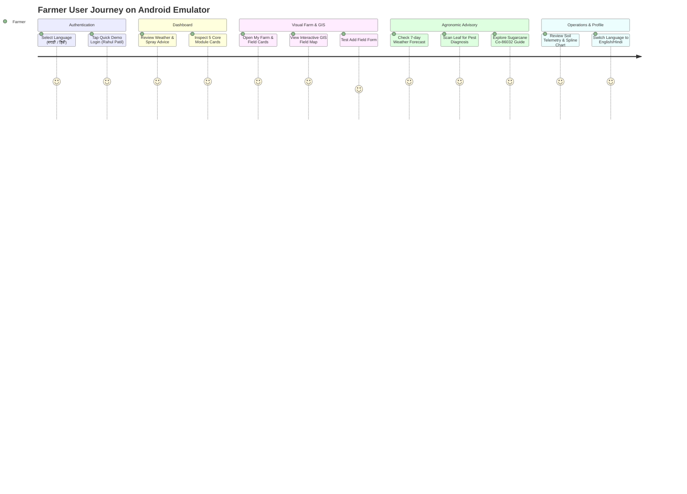

# KisanSaathi — React Native Architecture & Android Emulator Execution Plan

**Application Stack:** React Native (Expo) + TypeScript  
**Target Platform:** Android (Emulator / Physical Device) + Web Preview  
**Target User:** Indian Farmers (Trilingual: English, हिंदी, मराठी)  
**Document Type:** Technical Implementation & Demonstration Blueprint  

---

## 1. Technology Stack Confirmation

To be 100% clear: **Our mobile application is built in React Native**.

The neighboring Kotlin project (`C:\Sam's Work\Kotlin-Farmer App`) is **strictly a backend & data asset** that provides:
- The pre-built Ktor REST API backend on port `8080`.
- The existing SQLite / PostgreSQL database schemas (`farmers`, `farms`, `fields`, `crops`, `activities`).
- Pre-seeded real Indian farm data for **Rahul Patil** (Baramati, Maharashtra).

Our mobile client will be built with:

| Tier | Chosen Technology | Rationale |
|---|---|---|
| **Framework** | **React Native (Expo SDK 52+ / TypeScript)** | Industry standard for cross-platform mobile development with rapid live-reload |
| **Navigation** | **React Navigation 7** (`@react-navigation/bottom-tabs`, `@react-navigation/native-stack`) | Smooth, native 60fps transitions and persistent bottom tab bar |
| **Styling & Design System** | **StyleSheet + React Native Paper / Tailwind (NativeWind)** | Custom agricultural theme with lush greens, accessible touch targets (>= 48px), and Devanagari Unicode support |
| **Localization (i18n)** | **Centralized Trilingual Dictionary (`i18n`)** | Instant switching between English, Hindi (हिंदी), and Marathi (मराठी) without app restart |
| **State & Local Storage** | **Zustand + AsyncStorage / Expo SecureStore** | Lightweight reactive state management with local persistence for offline-first resilience |
| **Networking** | **Axios with JWT Interceptor** | Robust HTTP client configured for Android emulator loopback (`10.0.2.2:8080`) |
| **GIS & Visuals** | **React Native SVG (`react-native-svg`) + Canvas** | Lightweight, high-performance rendering of farm boundary polygons on mobile |
| **Camera & Media** | **Expo ImagePicker & Expo Camera** | Simulated leaf photo capture and image preview for pest detection |

---

## 2. React Native Project Directory Structure

```text
farmer-mobile-app/
├── app.json                     # Expo configuration (App name, bundle ID, splash, icons)
├── package.json                 # React Native & Expo dependencies
├── tsconfig.json                # Strict TypeScript configuration
├── App.tsx                      # Root application entry point with Auth & i18n providers
├── src/
│   ├── api/                     # Backend API client & endpoints
│   │   ├── client.ts            # Axios instance with 10.0.2.2 / base URL configuration
│   │   ├── authApi.ts           # Login, register, logout endpoints
│   │   ├── farmApi.ts           # Farms, fields, and boundary polygons
│   │   ├── weatherApi.ts        # Open-Meteo agro-weather integration
│   │   ├── pestApi.ts           # Leaf analysis & disease diagnoses
│   │   └── syncApi.ts           # Offline sync batch endpoints
│   │
│   ├── assets/                  # Images, icons, and fonts
│   │   ├── logo/                # KisanSaathi emblem
│   │   ├── crops/               # Realistic crop photography (Sugarcane, Wheat, Onion, Tomato)
│   │   └── icons/               # Agricultural SVG icons
│   │
│   ├── components/              # Reusable UI components
│   │   ├── common/              # Button, Input, Card, Header, Badge, Modal, Toast
│   │   ├── WeatherCard.tsx      # Floating weather widget with spray advisory
│   │   ├── FieldPolygonMap.tsx  # SVG-based interactive GIS farm boundary canvas
│   │   ├── PestScannerView.tsx  # Visual camera view with laser scanning animation
│   │   └── TrilingualText.tsx   # Typography wrapper with Devanagari font fallback
│   │
│   ├── hooks/                   # Custom hooks
│   │   ├── useAuth.ts           # Farmer authentication & session management
│   │   ├── useLanguage.ts       # Trilingual language selector (EN / HI / MR)
│   │   ├── useWeather.ts        # Live weather & spray advice calculator
│   │   └── useOfflineSync.ts    # Queue and synchronize offline edits
│   │
│   ├── i18n/                    # Centralized translations
│   │   ├── index.ts             # Language switcher logic
│   │   ├── en.json              # English strings
│   │   ├── hi.json              # Hindi (हिंदी) strings
│   │   └── mr.json              # Marathi (मराठी) strings
│   │
│   ├── navigation/              # React Navigation routers
│   │   ├── RootNavigator.tsx    # Auth vs App stack switcher
│   │   ├── AppTabs.tsx          # 4-tab bottom navigation (Home, My Farm, Advisory, Profile)
│   │   └── types.ts             # Navigation route params & TypeScript types
│   │
│   ├── screens/                 # All 8 Application Screens
│   │   ├── auth/
│   │   │   ├── LoginScreen.tsx        # Screen A: Mobile login + Trilingual toggle + Demo Quick-Login
│   │   │   └── RegisterScreen.tsx     # New farmer onboarding
│   │   ├── dashboard/
│   │   │   └── DashboardScreen.tsx    # Screen B: Personalized greeting, weather, 5 module cards, alerts
│   │   ├── farm/
│   │   │   ├── MyFarmScreen.tsx       # Screen C: Visual acreage, crop cards, Add Farm / Field modals
│   │   │   ├── FieldDetailScreen.tsx  # Plot details, soil specs, crop lifecycle
│   │   │   └── GisMapScreen.tsx       # Screen G1 (Module 4): Interactive GIS polygon boundary map
│   │   ├── advisory/
│   │   │   ├── WeatherScreen.tsx      # Screen D (Module 1): 7-day agro-forecast & spray window
│   │   │   ├── PestScannerScreen.tsx  # Screen E (Module 2): Leaf photo diagnosis & remedies
│   │   │   └── SugarcaneScreen.tsx    # Screen F (Module 3): Co-86032 stages, NPK & Brix harvest
│   │   ├── telemetry/
│   │   │   └── ActivitiesScreen.tsx   # Screen G2 (Module 5): Agronomy log & soil moisture spline chart
│   │   └── profile/
│   │       └── ProfileScreen.tsx      # Screen H: Language change, sync status, helpline, logout
│   │
│   ├── store/                   # Reactive state stores (Zustand)
│   │   ├── authStore.ts         # User token, farmer profile
│   │   ├── farmStore.ts         # Farms, fields, crops cache
│   │   └── syncStore.ts         # Pending sync mutations queue
│   │
│   └── types/                   # Shared TypeScript definitions
│       └── index.ts             # Farmer, Farm, Field, Crop, Activity, Weather, Pest types
```

---

## 3. What to Show on the Android Emulator (Step-by-Step Demo Script)

When demonstrating KisanSaathi on the Android Emulator to a client, professor, or evaluator, follow this exact flow:



### Demonstration Walkthrough:

#### Step 1: Welcome & Authentication Screen (Screen A)
- **What is on screen**: KisanSaathi logo with the tagline *"Better Farming, Brighter Future"*, an agricultural green theme, and an immediate **Trilingual Switcher** (`English` | `हिंदी` | `मराठी`).
- **What to demonstrate**:
  1. Tap **हिंदी** or **मराठी**: The whole screen changes instantaneously into Devanagari script without reloading.
  2. Tap the **"⚡ Quick Demo Login: Rahul Patil"** button: Automatically fills mobile `9822012345` and password `farmer123`.
  3. Tap **Login**: Smoothly transitions to the Farmer Dashboard.

#### Step 2: Farmer Dashboard (Screen B)
- **What is on screen**:
  - Curved deep forest green banner with: *"Namaste, Rahul Patil! 🙏"* (or *"नमस्कार, राहुल पाटील!"*), date, and location (*Malegaon, Baramati, Pune*).
  - Floating weather widget showing: **31°C, Partly Cloudy, 72% Humidity** + Actionable Agronomic Advice: *"Optimal day for pesticide or foliar fertilizer spray"*.
  - **My Farm Snapshot Card**: 12.5 Acres, 3 Fields (Sugarcane 5 Ac, Wheat 4 Ac, Red Onion 2 Ac).
  - **5 Module Action Cards**:
    1. ⛅ Weather & Advice
    2. 🐛 Pest & Disease Scan
    3. 🎋 Sugarcane Guide
    4. 🗺️ GIS Field Map
    5. 📋 Agronomy Log & Telemetry
  - Urgent Farm Alerts & Reminders.
  - 4-Tab Bottom Navigation Bar (*Home, My Farm, Advisory, Profile*).

#### Step 3: My Farm — Visual Experience (Screen C)
- **What is on screen**:
  - Hero banner with farm acreage and soil type (*Deep Black Soil*).
  - 3 Field Cards with rich crop photos:
    - **Field 1: North Canal Block** (4.0 Ac) — *Wheat (HD-2967)* — Status: `Growing` — Soil: Black Cotton.
    - **Field 2: Well Plot** (5.0 Ac) — *Sugarcane (Co-86032)* — Status: `Grand Growth` — Drip Irrigated.
    - **Field 3: Roadside Plot** (3.5 Ac) — *Red Onion (Bhima Kiran)* — Status: `Ready for Harvest`.
  - Tap **"+ Add Field"** button: Opens an accessible modal to enter field name, acreage, crop, and soil type. Submit it and demonstrate immediate local update!
  - Tap **"Inspect Plot"**: Shows GPS coordinates, planting date, and crop health index.

#### Step 4: Interactive GIS Farm Map (Module 4)
- **What is on screen**:
  - Aerial/Satellite canvas rendering the real field polygon boundaries seeded from `FieldsTable.boundaryCoordinates`.
  - Green polygon for Field 1, Yellow polygon for Field 2, Red-orange polygon for Field 3.
  - Interactive tap: Tap any polygon on the emulator screen to highlight it and open a bottom sheet with field telemetry, acreage, and crop variety.

#### Step 5: Weather & Agro-Advisory Screen (Module 1)
- **What is on screen**:
  - Current temperature, high/low, precipitation, humidity (72%), wind speed (8 km/h), atmospheric pressure.
  - Astronomical sunrise (06:14 AM) and sunset (06:08 PM) cycle.
  - **Spray Safety Index**: Explicit green badge (*"EXCELLENT: Low wind & no immediate rain risk"*).
  - **Irrigation Guidance**: Advice on whether to turn on pumps or save electricity based on forecast.
  - 7-Day agricultural weather cards.

#### Step 6: Pest & Disease Leaf Scanner (Module 2)
- **What is on screen**:
  - Crop selector (*Sugarcane / Tomato / Wheat / Onion*).
  - Camera preview frame with a diseased leaf.
  - Tap **"Scan Leaf"**: Visual laser scan animation sweeps across the leaf for 1.5 seconds.
  - **Diagnosis Result**:
    - Identified: **Sugarcane Red Rot (*Colletotrichum falcatum*)**
    - Confidence: **94%** | Severity: **Moderate**
    - Symptoms: Internal pith reddening, yellowing of midrib.
    - **🌿 Organic Remedy**: Trichoderma harzianum soil drenching (2.5 kg/ha) & burning infected clumps.
    - **🧪 Chemical Treatment**: Carbendazim 50% WP @ 1g/L sett treatment.
    - Prototype notice: Clear label indicating simulated AI diagnosis.

#### Step 7: Sugarcane Cultivation & Guidance (Module 3)
- **What is on screen**:
  - Target variety: **Co-86032 (Nira)** — Adsali season (15-18 months).
  - 4 Lifecycle Stages: Germination -> Tillering -> Grand Growth (Active) -> Maturity.
  - Stage-specific guidance for drip irrigation, earthing up, and stem borer control.
  - **Agronomic Calculators**:
    - Seed Sett Calculator (calculates two-eye buds needed per acre).
    - Fertilizer N:P:K Dose Calculator (250:115:115 kg/ha).
    - Brix Maturity Indicator (>18% Brix indicates peak sugar recovery).

#### Step 8: Farm Activities & Telemetry (Module 5)
- **What is on screen**:
  - Plant Health Index: **95%** | Soil Moisture: **72%** | Soil pH: **6.8**.
  - 7-Day Spline Trend Chart showing soil moisture levels over time.
  - Activity Log timeline (Irrigation on 08 Oct, Urea on 05 Oct, Weeding on 01 Oct).
  - Tap **"+ Log Activity"** button: Modal to record new task with date and notes.
  - Offline Sync indicator badge: *"🟢 All synced with central server"*.

#### Step 9: Profile, Settings & Trilingual QA (Screen H)
- **What is on screen**:
  - Farmer profile card for Rahul Patil (`MH-PUN-0924`).
  - Trilingual radio selector: Switch to Marathi or Hindi. All navigation tabs, headers, buttons, and alerts update instantly.
  - Kisan Call Center helpline button (`1800-180-1551`).
  - Logout button: Returns to Screen A.

---

## 4. How to Launch and Test on the Android Emulator

### 4.1 Prerequisites on Windows
1. **Node.js** & **npm.cmd** (already installed: Node 24, npm 11.17).
2. **Android Studio & Android Emulator**:
   - If Android Studio is installed, ensure the Android SDK path (`%LOCALAPPDATA%\Android\Sdk`) is in your environment variables.
   - A virtual device (AVD) such as `Pixel 7 - API 34` or `Pixel 8 - API 35` created via Android Studio's Device Manager.

### 4.2 Step-by-Step PowerShell Commands to Run

```powershell
# 1. Open Windows PowerShell in the project directory
cd "c:\Sam's Work\Farmer-Mobile_App"

# 2. Start the existing Ktor Backend (in a separate terminal)
# This serves the REST APIs on http://localhost:8080
cd "c:\Sam's Work\Kotlin-Farmer App"
.\gradlew.bat :backend:run

# 3. Launch your Android Emulator from Android Studio OR via command line:
# %LOCALAPPDATA%\Android\Sdk\emulator\emulator.exe -avd Pixel_7_API_34

# 4. Start the React Native (Expo) app in your Farmer-Mobile_App terminal:
cd "c:\Sam's Work\Farmer-Mobile_App"
npx.cmd expo start --android
```

### 4.3 Why `10.0.2.2` is Critical on the Emulator

```text
+-----------------------------+         +-------------------------------+
|     Android Emulator        |         |      Windows Host PC          |
|                             |         |                               |
|   React Native App          |  HTTP   |   Ktor Backend Server         |
|   http://10.0.2.2:8080/api  | ------> |   http://localhost:8080/api   |
+-----------------------------+         +-------------------------------+
```

When React Native code runs inside the Android Emulator, `localhost` refers to the emulator's internal virtual Android OS, **not** your Windows PC.
To communicate with the Ktor backend running on Windows, the mobile app uses **`http://10.0.2.2:8080`**, which is Android's special alias routing to the host machine's loopback interface.

---

## 5. Phased Delivery Workflow

To ensure smooth progress:

1. **Step 1 (Now - Phase 2)**: Create the **Interactive Clickable Prototype** in `farmer-app-prototype/`. This validates every visual design, trilingual string, touch interaction, and mock data flow in a browser mobile-emulator view before writing native code.
2. **Step 2 (Phase 6)**: Initialize the **React Native Expo TypeScript** codebase in `farmer-mobile-app/` with the exact directory architecture defined above.
3. **Step 3 (Phase 7 & 8)**: Connect React Native to the Ktor backend via `10.0.2.2:8080`, verify in the Android Emulator (AVD), and execute the complete QA test checklist.
