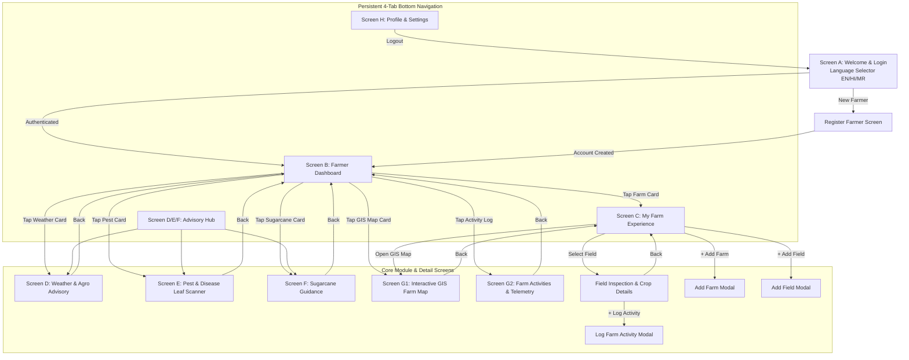

# KisanSaathi — Mobile Screen Flow & User Journeys

**Product:** KisanSaathi — Better Farming, Brighter Future  
**Designer & UI Architect:** Senior UI/UX Designer & Full-Stack Architect  
**Version:** 1.0 (Phase 1 Deliverable)  

---

## 1. Application Navigation Architecture

KisanSaathi is designed to provide immediate clarity to Indian farmers. The interface employs a primary **Bottom Navigation Bar** with 4 persistent tabs, coupled with contextual stacked screens and bottom-sheet modals.



---

## 2. Detailed Screen Specifications

### Screen A: Welcome & Authentication

```text
+---------------------------------------------------+
|  [Logo] KisanSaathi / किसान साथी / किसान साथी      |
|  Better Farming, Brighter Future                  |
|                                                   |
|  [ Language: English  |  हिंदी  |  मराठी ]         |
+---------------------------------------------------+
|  Mobile Number / मोबाईल नंबर                       |
|  [ 9822012345                              ]      |
|                                                   |
|  Password / पासवर्ड                                |
|  [ ••••••••                          (Show) ]     |
|                                                   |
|  [ ===== LOGIN / लॉगिन ===== ]                     |
|                                                   |
|  [ ⚡ Quick Demo Login: Rahul Patil (Baramati) ]   |
|                                                   |
|  Don't have an account? Register Here             |
+---------------------------------------------------+
```

- **Top Bar**: High-contrast branding with trilingual selector.
- **Form Controls**: Large touch targets (minimum 48px height), auto-formatting for 10-digit Indian mobile numbers.
- **Demo Quick-Login**: Instant prefill of Rahul Patil's demo credentials (`9822012345` / `farmer123`) to streamline evaluator testing.
- **Validation**:
  - Validates 10-digit mobile number with localized error messages.
  - Password minimum length enforcement (6+ characters).
  - Clear error toast if credentials do not match.

---

### Screen B: Farmer Dashboard (Home Tab)

```text
+---------------------------------------------------+
| [Green Banner]                                    |
| Namaste, Rahul Patil! 🙏           [Avatar MH]     |
| Sunday, 10 Oct 2026 | Malegaon, Baramati, Pune    |
| [ Search crops, pests, advisory... (Mic) ]        |
+---------------------------------------------------+
| [Weather Floating Card]                           |
| ⛅ Baramati: 31°C  (H: 33° L: 21°)   Cloudy       |
| Humidity: 72% | Rain: 10% | Wind: 8 km/h         |
| 💡 Advisory: "Optimal weather for foliar spray"    |
+---------------------------------------------------+
| [My Farm Snapshot]                                |
| Rahul Krishi Farm • 12.5 Acres • 3 Fields         |
| Active Crops: Sugarcane (5 Ac), Wheat (4 Ac),     |
|               Red Onion (2 Ac)                    |
| [View Farm Details ->]                            |
+---------------------------------------------------+
| [Five Core Module Cards]                          |
| [⛅ Weather Advice]     [🐛 Pest & Disease Scan]  |
| [🎋 Sugarcane Guide]    [🗺️ GIS Field Map]       |
| [📋 Agronomy Activities & Soil Telemetry]         |
+---------------------------------------------------+
| [Farm Alerts & Reminders]                         |
| ⚠️ Sugarcane Field 2: Drip fertigation due today   |
| 🌾 Red Onion Field 3: Ready for harvest lifting   |
+---------------------------------------------------+
| [Bottom Nav: Home | My Farm | Advisory | Profile] |
+---------------------------------------------------+
```

- **Inspiration**: Directly implements the curved forest-green header and floating card structure from User Reference Screen 1.
- **Dynamic Greeting**: Automatically changes between "Good Morning / सुप्रभात / शुभ सकाळ" based on time of day.
- **Weather Widget**: Direct 1-tap navigation to detailed weather diagnostics.
- **Module Grid**: Staggered rounded cards with distinct iconography, high color contrast, and immediate touch responsiveness.

---

### Screen C: My Farm — Visual Farm Management Experience

```text
+---------------------------------------------------+
| <- Back          My Farm / माझी शेती       [+] Add |
+---------------------------------------------------+
| [Farm Hero Aerial Banner]                         |
| Rahul Krishi Farm                                 |
| Village: Malegaon, Taluka: Baramati, Dist: Pune   |
| Total Area: 12.5 Acres | 3 Plots | Deep Black Soil|
+---------------------------------------------------+
| [Interactive Field Selector]                      |
| [ Field 1: North Canal (4.0 Ac) - Wheat 🌾 ]      |
|   - Status: Growing (Sown 15 Nov)                 |
|   - Soil: Black Cotton Soil | Health: 96%         |
|                                                   |
| [ Field 2: Well Plot (5.0 Ac) - Sugarcane 🎋 ]    |
|   - Status: Grand Growth (Co-86032)               |
|   - Irrigation: Drip | Health: 94%                |
|                                                   |
| [ Field 3: Roadside Plot (3.5 Ac) - Onion 🧅 ]    |
|   - Status: Ready for Harvest                     |
|   - Variety: Bhima Kiran | Health: 98%            |
+---------------------------------------------------+
| [Visual Farm Layout / Field Polygons Preview]     |
| [Interactive Map Card with Highlighted Plots]     |
| [ Open Full Interactive GIS Satellite Map -> ]    |
+---------------------------------------------------+
```

- **Visual Emphasis**: Crop photography and satellite field boundary previews replacing boring text tables.
- **Field Card Actions**: Tap any field to open **Field Details** showing cultivation timeline, soil telemetry, and logged tasks.
- **Add Farm / Add Field Modals**: Clean, accessible forms to add acreage, plot name, crop type, and soil category.

---

### Screen D: Weather & Weather-Based Advisory

```text
+---------------------------------------------------+
| <- Back       Weather & Advisory / हवामान सल्ला    |
+---------------------------------------------------+
| [Current Conditions Card]                         |
| Malegaon, Baramati • 31°C • Partly Cloudy         |
| High: 33°C | Low: 21°C | Precipitation: 1.2 mm    |
| Humidity: 72% | Wind: 8 km/h | Pressure: 940 hPa   |
| Sunrise: 06:14 AM  🌅  Sunset: 06:08 PM 🌇        |
+---------------------------------------------------+
| [Agronomic Advisory of the Day]                   |
| 🟢 Spraying Conditions: EXCELLENT                 |
| "Low wind speed and moderate humidity make today  |
| ideal for pesticide or micronutrient foliar spray"|
|                                                   |
| 🔵 Irrigation Advisory: HOLD AFTERNOON WATERING   |
| "Soil moisture remains optimal at 72%. Conserve   |
| borewell energy."                                 |
+---------------------------------------------------+
| [7-Day Agricultural Forecast Cards]               |
| Mon: 32°C / 21°C  ⛅ Partly Cloudy  (10% Rain)    |
| Tue: 30°C / 22°C  🌧️ Light Showers  (55% Rain)    |
| Wed: 29°C / 20°C  🌧️ Moderate Rain  (70% Rain)    |
| Thu: 31°C / 21°C  ⛅ Clearing        (15% Rain)    |
+---------------------------------------------------+
| [Agronomy Notes Timeline & + Add Note]            |
+---------------------------------------------------+
```

- **Inspiration**: Directly implements the Bekasi/Baramati Weather + Agronomy Notes layout from Reference Screen 1.
- **Farmer Notes**: Allows farmers to add timestamps and observations (e.g., *"Noticed slight aphid infestation on south boundary"*).

---

### Screen E: Pest & Disease Detection (Leaf Scanner)

```text
+---------------------------------------------------+
| <- Back     Plant Health & Pest Scanner           |
| Filter: [ All | In Scanning | Completed ]         |
+---------------------------------------------------+
| [Crop Selector: Sugarcane | Wheat | Tomato | Onion]|
|                                                   |
| [Visual Photo Scanner Frame]                      |
| +-----------------------------------------------+ |
| | [Photo of diseased leaf with laser scan line] | |
| |        "Scanning & Analyzing Symptoms..."     | |
| +-----------------------------------------------+ |
| [ 📷 Take Photo ]    [ 🖼️ Upload from Gallery ]   |
+---------------------------------------------------+
| [Simulated Diagnosis Result Card]                 |
| 🔴 Condition: Sugarcane Red Rot (Colletotrichum)  |
| Confidence: 94% | Severity: Moderate              |
|                                                   |
| 🔍 Symptoms: Reddening of internal pith, yellow-  |
|    ing of third leaf from top.                    |
|                                                   |
| 🌿 Organic Remedy:                                |
| - Trichoderma harzianum soil drenching (2.5 kg/ha)|
| - Remove and burn infected clumps immediately.    |
|                                                   |
| 🧪 Recommended Chemical Treatment:               |
| - Carbendazim 50% WP @ 1g/L sett treatment.       |
| - Carbendazim + Mancozeb foliar spray.            |
+---------------------------------------------------+
| ⚠️ Prototype Notice: Illustrative AI diagnostic    |
+---------------------------------------------------+
```

- **Inspiration**: Perfectly matches the "Plant Health" scanner in User Reference Screen 3 with visual scanning animations and organic/chemical advice.

---

### Screen F: Sugarcane Cultivation & Guidance

```text
+---------------------------------------------------+
| <- Back         Sugarcane Guide / ऊस पीक सल्ला     |
+---------------------------------------------------+
| [Cultivar Focus: Co-86032 (Nira) & Co-0238]       |
| Season: Adsali (15-18 mo) / Pre-seasonal (12 mo)  |
+---------------------------------------------------+
| [Lifecycle Stage Navigator]                       |
| [1. Germination] -> [2. Tillering] ->             |
| [3. Grand Growth (ACTIVE)] -> [4. Maturity]       |
+---------------------------------------------------+
| [Active Stage: Grand Growth (Days 101–270)]       |
| 💧 Irrigation: 70–80mm per turn (drip 4 hrs/day)  |
| 🌾 Fertilizer: Potash (MOP) 50kg/acre top-dress   |
| 🐛 Pest Watch: Stem Borer & White Fly monitoring  |
| ✂️ Earthing Up: Second earthing-up completed      |
+---------------------------------------------------+
| [Interactive Agronomic Calculators]               |
| - Seed Sett Requirement Calculator (Per Acre)     |
| - Fertilizer N:P:K Dose Calculator                |
| - Harvest Readiness Brix Tester (Brix > 18%)      |
+---------------------------------------------------+
```

---

### Screen G1: Interactive GIS Farm Map *(Discovered Module 4)*

```text
+---------------------------------------------------+
| <- Back          Interactive GIS Farm Map         |
+---------------------------------------------------+
| [Satellite / Hybrid / Terrain Layer Selector]     |
| [Zoom + / -]  [Locate GPS Dot]                    |
|                                                   |
| [Interactive Canvas / Map Display]                |
| +-----------------------------------------------+ |
| | [Green Polygon 1: North Canal Block (4.0 Ac)] | |
| | [Yellow Polygon 2: Well Plot (5.0 Ac)]        | |
| | [Red Polygon 3: Roadside Plot (3.5 Ac)]       | |
| +-----------------------------------------------+ |
+---------------------------------------------------+
| [Bottom Inspection Sheet: Selected Plot]          |
| Field 2: Well Plot (5.0 Acres)                    |
| Crop: Sugarcane Co-86032 | Soil: Clay Loam        |
| Moisture: 68% (Optimal) | GPS: 18.1519°N, 74.5789°E|
+---------------------------------------------------+
```

- **Inspiration**: Matches the aerial satellite field layout with highlighted polygons from Reference Screen 3.

---

### Screen G2: Agronomy Activities & Telemetry *(Discovered Module 5)*

```text
+---------------------------------------------------+
| <- Back         Farm Activities & Telemetry       |
| Sync Status: 🟢 All synced with server            |
+---------------------------------------------------+
| [Farm Health Index Cards]                         |
| Health: 95% | Avg Soil Moisture: 72% | pH: 6.8    |
+---------------------------------------------------+
| [7-Day Spline Trend Chart: Soil Moisture & Growth]|
+---------------------------------------------------+
| [Activity Log Timeline]                           |
| - 08 Oct: Irrigation (Well Plot) - 4 hours drip   |
| - 05 Oct: Fertilizer - Urea 50kg (Canal Block)    |
| - 01 Oct: Weeding - Manual intercultural weeding  |
| [+ Log New Activity]                              |
+---------------------------------------------------+
```

---

### Screen H: Farmer Profile & Settings

```text
+---------------------------------------------------+
| Profile & Settings / शेतकरी प्रोफाइल               |
+---------------------------------------------------+
| [Farmer Card: Rahul Patil | Code: MH-PUN-0924]    |
| Phone: +91 9822012345 | Village: Malegaon, Pune   |
+---------------------------------------------------+
| [Language Preferences]                            |
| ( ) English   ( ) हिंदी   (*) मराठी               |
+---------------------------------------------------+
| [Farm Information Summary]                        |
| Total Acreage: 12.5 Acres | Farms: 1 | Fields: 3   |
+---------------------------------------------------+
| [Offline Sync Center]                             |
| Status: Healthy | Server: Ktor (Port 8080)        |
+---------------------------------------------------+
| [Kisan Call Center / Helpline: 1800-180-1551]     |
| [Logout Button]                                   |
+---------------------------------------------------+
```
